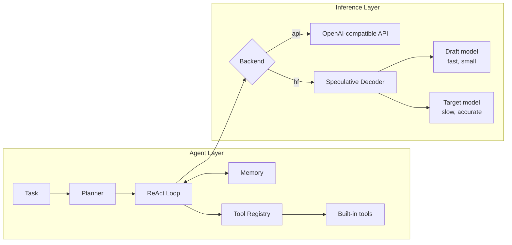
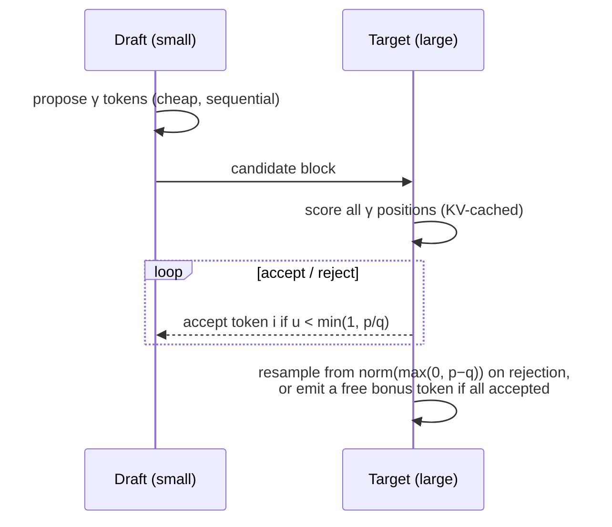

# AgentSpec

**A lightweight LLM agent framework with speculative-decoding-accelerated inference.**

AgentSpec combines two things that usually live in separate repos:

1. **Agent layer** - ReAct and Plan-and-Execute loops, a typed tool registry with automatic JSON-schema generation, and short/long-term memory.
2. **Inference layer** - a clean, well-tested implementation of *speculative decoding* (draft-then-verify, Leviathan et al. 2023) that works with any pair of HuggingFace models sharing a tokenizer, with KV-cache-aware incremental scoring.

The **core library is pure Python (stdlib only)** - you can run the full test-suite and the agent demo with zero dependencies, no GPU, and no API key.

## Why

Agent loops spend most of their wall-clock time inside LLM calls, and most agent frameworks treat the model as a black box. AgentSpec treats *inference acceleration as a first-class agent concern*: a speculative backend makes multi-step reasoning loops measurably cheaper on commodity GPUs.

## Features

- **ReAct agent** with robust output parsing (code fences, trailing prose, malformed JSON recovery, hallucinated-observation guard)
- **Plan-and-Execute agent** - decompose a task, run a fresh ReAct agent per step, synthesize
- **Tool system** - decorator-based registry, JSON schemas from type hints, safe AST-based calculator (no `eval`)
- **Memory** - sliding-window conversation memory + IDF keyword long-term store
- **Speculative decoding** - exact draft/verify sampling with acceptance-rate statistics; greedy mode is bit-identical to plain autoregressive decoding (tested)
- **Backends** - local HuggingFace models (KV-cached), any OpenAI-compatible API (stdlib `urllib`, no SDK), deterministic mocks for tests
- **CI-ready** - 23 unit tests, GitHub Actions workflow, MIT license

## Architecture



One speculative round:



## Quickstart

```bash
git clone https://github.com/your-username/agentspec.git
cd agentspec

# zero-dependency: run tests and the scripted agent demo
python run_tests.py
python examples/react_demo.py --backend mock
```

### Use an OpenAI-compatible API

```bash
export OPENAI_API_KEY=sk-...
export OPENAI_BASE_URL=https://api.deepseek.com/v1   # any compatible endpoint
python examples/react_demo.py --backend api --model deepseek-chat \
    --task "What is (128 * 46) + sqrt(81)?"
```

### Speculative decoding on a local GPU (6 GB is enough)

```bash
pip install -e ".[hf]"
python examples/speculative_benchmark.py \
    --target Qwen/Qwen2.5-1.5B-Instruct \
    --draft  Qwen/Qwen2.5-0.5B-Instruct \
    --gamma 4 --max-new-tokens 128
```

The benchmark prints per-prompt tokens/s, the draft **acceptance rate**, average **tokens per round**, and the overall speedup vs. plain autoregressive decoding. (Numbers depend on your hardware - run it and see; on small Qwen2.5 pairs greedy acceptance is typically high because the draft shares the tokenizer and training data lineage.)

### Use it as a library

```python
from agentspec import ReActAgent, build_default_registry
from agentspec.llm.api_backend import OpenAICompatibleChatLLM

agent = ReActAgent(OpenAICompatibleChatLLM(model="deepseek-chat"), build_default_registry())
result = agent.run("What is (128 * 46) + sqrt(81)?")
print(result.answer)   # 5897
print(result.trace)    # full Thought/Action/Observation transcript
```

```python
from agentspec.llm.hf_backend import HFCausalLM
from agentspec.llm.speculative import speculative_decode

target = HFCausalLM("Qwen/Qwen2.5-1.5B-Instruct")
draft = HFCausalLM("Qwen/Qwen2.5-0.5B-Instruct")
result = speculative_decode(target, draft, "The KV-cache is", max_new_tokens=64, gamma=4)
print(result.text)
print(f"acceptance: {result.stats.acceptance_rate:.0%}")
```

## Project layout

```
agentspec/
├── src/agentspec/
│   ├── llm/
│   │   ├── base.py          # ChatLLM / TokenModel abstractions
│   │   ├── speculative.py   # draft-then-verify decoding (pure Python core)
│   │   ├── hf_backend.py    # HuggingFace backend with KV-cache
│   │   ├── api_backend.py   # OpenAI-compatible client (stdlib urllib)
│   │   └── mock.py          # deterministic mocks for tests & demos
│   ├── agent/
│   │   ├── react.py         # ReAct loop + robust parsing
│   │   ├── planner.py       # Plan-and-Execute
│   │   └── memory.py        # short-term window + long-term retrieval
│   └── tools/
│       ├── registry.py      # decorator registry, JSON-schema generation
│       └── builtin.py       # safe AST calculator, time, word count
├── examples/                # runnable demos & benchmarks
├── tests/                   # 23 unit tests, no GPU / network needed
├── docs/architecture.md     # design notes
└── .github/workflows/ci.yml
```

## Roadmap

- [ ] Medusa-style multi-head drafting
- [ ] EAGLE-style feature-level drafting
- [ ] Batched (single-pass) target verification
- [ ] Async / concurrent tool execution
- [ ] Vector-store memory backend

## 中文简介

AgentSpec 是一个把 **Agent 框架**与**投机解码推理加速**结合在一起的轻量级项目：

- Agent 层：ReAct / Plan-Execute 双模式、工具注册与 JSON Schema 自动生成、短期/长期记忆；
- 推理层：完整实现 Leviathan et al. 2023 的投机采样算法（草稿模型提议 + 目标模型验证 + 拒绝重采样），支持任意共享 tokenizer 的 HuggingFace 模型对，内置 KV-cache 增量推理；
- 核心库零第三方依赖，`python run_tests.py` 即可离线运行全部 23 个单元测试；
- RTX 4050（6GB 显存）即可跑 `Qwen2.5-0.5B` + `Qwen2.5-1.5B` 的投机解码基准：`python examples/speculative_benchmark.py`。

## License

MIT
