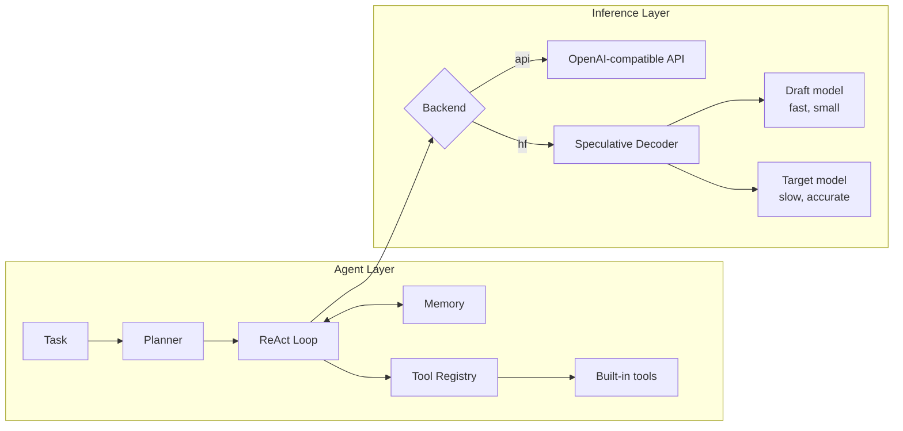
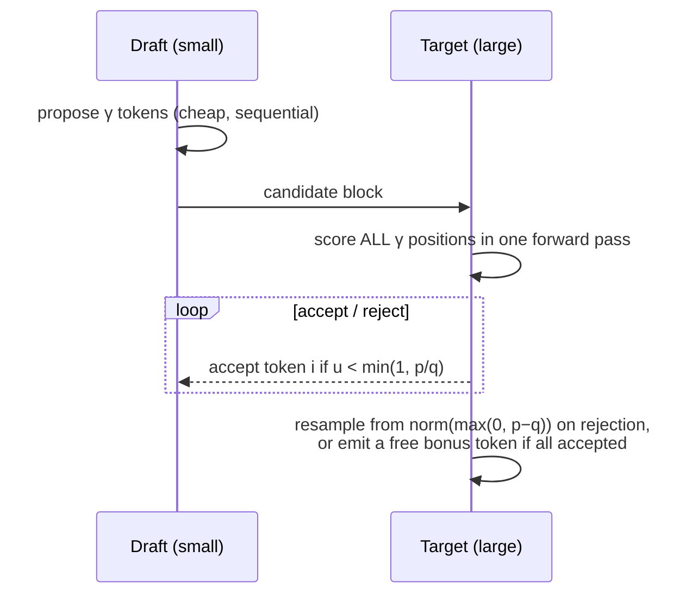

# AgentSpec

**A lightweight LLM agent framework with speculative-decoding-accelerated inference.**

AgentSpec combines two things that usually live in separate repos:

1. **Agent layer** - ReAct and Plan-and-Execute loops, a typed tool registry with automatic JSON-schema generation, and short/long-term memory.
2. **Inference layer** - a clean, well-tested implementation of *speculative decoding* (draft-then-verify, Leviathan et al. 2023) with **batched target verification**: a whole draft block is scored in one forward pass, with KV-cache cropping and GPU-side sampling.

The **core library is pure Python (stdlib only)** - you can run the full test-suite and the agent demo with zero dependencies, no GPU, and no API key.

## Why

Agent loops spend most of their wall-clock time inside LLM calls, and most agent frameworks treat the model as a black box. AgentSpec treats *inference acceleration as a first-class agent concern*: a speculative backend makes multi-step reasoning loops measurably cheaper on commodity GPUs.

## Features

- **ReAct agent** with robust output parsing (code fences, trailing prose, malformed JSON recovery, hallucinated-observation guard)
- **Plan-and-Execute agent** - decompose a task, run a fresh ReAct agent per step, synthesize
- **Tool system** - decorator-based registry, JSON schemas from type hints, safe AST-based calculator (no `eval`)
- **Memory** - sliding-window conversation memory + IDF keyword long-term store
- **Speculative decoding** - exact draft/verify sampling with acceptance-rate statistics; greedy mode is bit-identical to plain autoregressive decoding (tested). Two implementations: a pure-Python reference algorithm (`speculative.py`, fully unit-tested with mock models) and a GPU-optimized HF path (`speculative_decode_hf`) with one batched verification pass per round
- **Backends** - local HuggingFace models (KV-cached), any OpenAI-compatible API (stdlib `urllib`, no SDK), deterministic mocks for tests
- **CI-ready** - 23 unit tests, GitHub Actions workflow, MIT license

## Architecture



One speculative round:



The HF backend implements this with `verify_block_logits()`: the cache covers
`prefix[:-1]`, the forward input is `[prefix[-1]] + candidate_block`, and each
output position yields one verification distribution plus the bonus
distribution. After each round the KV-cache is cropped back to the last valid
prefix, which is necessary because a rejection makes the cached KV of the
diverged draft positions stale. All sampling stays on the GPU.

## Quickstart

```bash
git clone https://github.com/lei080359-byte/AgentSpec.git
cd agentspec

# zero-dependency: run tests and the scripted agent demo
python run_tests.py
python examples/react_demo.py --backend mock
```

### Use an OpenAI-compatible API

```bash
export OPENAI_API_KEY=sk-...
export OPENAI_BASE_URL=https://api.deepseek.com/v1   # any compatible endpoint
python examples/react_demo.py --backend api --model deepseek-chat \
    --task "What is (128 * 46) + sqrt(81)?"
```

### Speculative decoding on a local GPU (6 GB is enough)

```bash
pip install -e ".[hf]"
python examples/speculative_benchmark.py \
    --target Qwen/Qwen2.5-1.5B-Instruct \
    --draft  Qwen/Qwen2.5-0.5B-Instruct \
    --gamma 4 --max-new-tokens 128
```

The benchmark prints per-prompt tokens/s, the draft **acceptance rate**, average **tokens per round**, and the overall speedup vs. plain autoregressive decoding. `bench_sweep.py` additionally sweeps `gamma` and compares free-form text against structured agent trajectories. Both scripts do an untimed warmup pass.

## Benchmark (measured, not estimated)

Hardware: **RTX 4090 D, 24 GB** (AutoDL cloud instance). Models:
`Qwen/Qwen2.5-7B-Instruct` (target) + `Qwen/Qwen2.5-0.5B-Instruct` (draft),
bf16, greedy decoding, 128 new tokens per prompt, KV-cache on, both paths use
GPU-side argmax. Reproduce with `python examples/bench_sweep.py`.

**γ = 4, all six prompts (no cherry-picking):**

| Prompt | Acceptance | Tokens / round | Speculative | Autoregressive | Speedup |
|---|---|---|---|---|---|
| general: KV-cache explanation | 30% | 2.17 | 7.04 s | 2.97 s | x0.42 |
| general: palindrome function | 64% | 3.56 | 4.55 s | 2.72 s | x0.60 |
| general: summarize spec-decoding | 22% | 1.87 | 8.17 s | 2.87 s | x0.35 |
| agent: ReAct trajectory continuation | **100%** | **4.96** | 2.57 s | 2.86 s | **x1.11** |
| agent: repeated JSON objects | 67% | 3.66 | 3.44 s | 2.99 s | x0.87 |
| agent: repeated status lines | 59% | 3.37 | 3.98 s | 2.94 s | x0.74 |

**γ sweep (overall speedup across each 3-prompt set):**

| γ | Free-form text | Agent trajectories | Best single prompt |
|---|---|---|---|
| 2 | x0.70 | x0.96 | agent-1 x1.07 |
| 3 | x0.61 | x0.86 | agent-1 x1.11 |
| 4 | x0.43 | x0.88 | agent-1 x1.11 |
| 6 | x0.42 | x0.84 | agent-1 **x1.12** (100% acceptance, 6.79 tokens/round) |

**What the numbers say.** Cost per token is roughly
`(γ · c + C_block) / k`, where `c` is a draft forward, `C_block` is one
multi-token target forward, and `k` is tokens committed per round. Structured
agent output is predictable → acceptance ≈ 100% → `k ≈ γ + 1` → **up to 1.12x
wall-clock speedup and 6.79 tokens per target forward**. Free-form prose with
a weak 0.5B draft only reaches 17–76% acceptance, so the extra draft work
outweighs the saving on a GPU that is already very fast at single-token 7B
decoding (~43 tok/s). Note also that Qwen2.5-7B and 0.5B have *different*
vocab sizes (152064 vs 151936); the implementation supports a draft whose
vocabulary is a subset of the target's by zero-padding `q` in the residual.

A reference implementation is not a production kernel: per-round Python
overhead, kernel-launch latency, and the missing CUDA-graph / paged-KV
optimizations limit the ceiling here. Real wins require a cheaper draft
(EAGLE/Medusa-style feature drafting or n-gram lookup), higher acceptance,
or memory-bound hardware. This benchmark intentionally reports the losing
cases too - see `docs/architecture.md` for the full cost-model discussion.

### Use it as a library

```python
from agentspec import ReActAgent, build_default_registry
from agentspec.llm.api_backend import OpenAICompatibleChatLLM

agent = ReActAgent(OpenAICompatibleChatLLM(model="deepseek-chat"), build_default_registry())
result = agent.run("What is (128 * 46) + sqrt(81)?")
print(result.answer)   # 5897
print(result.trace)    # full Thought/Action/Observation transcript
```

```python
from agentspec.llm.hf_backend import HFCausalLM, speculative_decode_hf

target = HFCausalLM("Qwen/Qwen2.5-7B-Instruct")
draft = HFCausalLM("Qwen/Qwen2.5-0.5B-Instruct")
# GPU path: one batched target forward per round
result = speculative_decode_hf(target, draft, "The KV-cache is", max_new_tokens=64, gamma=4)
print(result.text)
print(f"acceptance: {result.stats.acceptance_rate:.0%}, tokens/round: {result.stats.tokens_per_round:.2f}")
```

The pure-Python reference algorithm (`agentspec.llm.speculative.speculative_decode`)
has the same semantics and works with any `TokenModel` implementation - including
the dependency-free mocks used in the test-suite.

## Project layout

```
agentspec/
├── src/agentspec/
│   ├── llm/
│   │   ├── base.py          # ChatLLM / TokenModel abstractions
│   │   ├── speculative.py   # draft-then-verify decoding (pure Python core)
│   │   ├── hf_backend.py    # batched verification + GPU-side sampling
│   │   ├── api_backend.py   # OpenAI-compatible client (stdlib urllib)
│   │   └── mock.py          # deterministic mocks for tests & demos
│   ├── agent/
│   │   ├── react.py         # ReAct loop + robust parsing
│   │   ├── planner.py       # Plan-and-Execute
│   │   └── memory.py        # short-term window + long-term retrieval
│   └── tools/
│       ├── registry.py      # decorator registry, JSON-schema generation
│       └── builtin.py       # safe AST calculator, time, word count
├── examples/                # demo, benchmark, gamma sweep
├── tests/                   # 23 unit tests, no GPU / network needed
├── docs/architecture.md     # design notes
└── .github/workflows/ci.yml
```

## Roadmap

- [x] Batched (single-pass) target verification with KV-cache cropping
- [x] Measured benchmark: γ sweep, acceptance rate, structured vs free-form text
- [ ] Medusa-style multi-head drafting
- [ ] EAGLE-style feature-level drafting
- [ ] CUDA-graph / no-Python-sync draft proposals
- [ ] N-gram (prompt-lookup) drafting for zero-cost proposals
- [ ] Async / concurrent tool execution
- [ ] Vector-store memory backend

## 中文简介

AgentSpec 是一个把 **Agent 框架**与**投机解码推理加速**结合在一起的轻量级项目：

- Agent 层：ReAct / Plan-Execute 双模式、工具注册与 JSON Schema 自动生成、短期/长期记忆；
- 推理层：完整实现 Leviathan et al. 2023 的投机采样算法（草稿模型提议 + 目标模型验证 + 拒绝重采样），GPU 路径**一次前向验证整个候选块**并做 KV-cache 裁剪，greedy 输出与原模型逐 token 一致；
- 核心库零第三方依赖，`python run_tests.py` 即可离线运行全部 23 个单元测试；
- 已在 RTX 4090 D（24GB）上实测 `Qwen2.5-0.5B` + `7B` 组合：结构化 Agent 轨迹接受率 100%、单轮提交 6.79 token、最高 **1.12x** 加速；自由文本接受率低（17~76%）时反而更慢——完整数据与成本模型分析见上方 Benchmark 章节。

## License

MIT
